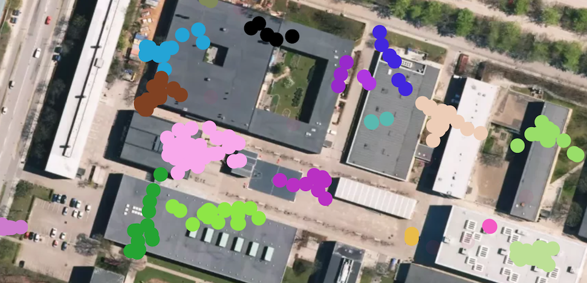

About Infostop
==============

Infostop detects stop locations in mobility data. It takes a time-ordered
trace of coordinates (GPS or otherwise) and gives each point the label of the
place where the person stayed, or ``-1`` if the point was recorded while the
person was moving. It can also label the traces of many people at once. Then a
place that several people visit gets the same label in each trace.

The method is described in `Aslak & Alessandretti (2020)`_.

Quick example
-------------

A day in GPS fixes: ten at home, three on the way to work, ten at work, three
on the way back, and ten at home again:

.. code-block:: pycon

   >>> import numpy as np
   >>> from infostop import Infostop
   >>> rng = np.random.default_rng(0)
   >>> home = np.array([55.6761, 12.5683])
   >>> work = np.array([55.6867, 12.5700])
   >>> def stay(place):  # 10 fixes within a few meters of `place`
   ...     return place + rng.normal(0, 1e-5, (10, 2))
   >>> def trip(a, b):  # 3 fixes on the way from `a` to `b`
   ...     return np.linspace(a, b, 5)[1:-1]
   >>> data = np.vstack([
   ...     stay(home), trip(home, work), stay(work), trip(work, home), stay(home)
   ... ])
   >>> Infostop().fit_predict(data)
   array([ 1,  1,  1,  1,  1,  1,  1,  1,  1,  1, -1, -1, -1,  2,  2,  2,  2,
           2,  2,  2,  2,  2,  2, -1, -1, -1,  1,  1,  1,  1,  1,  1,  1,  1,
           1,  1])

Both stays at home get the same label, work gets another, and the points on
the way get ``-1``. Labels are only IDs: the numbers themselves carry no
meaning. :doc:`usage/usage` explains the input format, the parameters and the
other tools in the package.

The figure shows points on a university campus, coloured by their stop
location label:

How it works
------------

1. **Downsample in time.** Infostop walks through each trace and groups
   consecutive points that stay within ``r1`` of the median of their group.
   A group with enough points (and, with timestamps, a long enough duration)
   is a *stationary event*. Infostop keeps only the median of each event.
   Points that are in no event get the label ``-1``.
2. **Cluster in space.** Event medians that are within ``r2`` of each other
   are linked in a network, and the `Infomap`_ algorithm clusters this network.
   Each cluster is a stop location.
3. **Label the input.** Each point gets the label of the stop location of its
   event.

Because the clustering uses flow in a network rather than distance alone,
Infostop can keep frequently visited places apart even when they are close
together, such as adjacent buildings. The paper compares this with other
methods.

Install
-------

.. code-block:: bash

   pip install infostop

Infostop includes a small C++ extension. If pip finds no prebuilt wheel for
your Python version and platform, it compiles the extension, and this needs a
C++ compiler. The ``README.md`` in the `public repository`_ has notes for
development installs.

Cite
----

If you use Infostop in your research, please cite:

   Ulf Aslak and Laura Alessandretti. *Infostop: scalable stop-location
   detection in multi-user mobility data.* arXiv:2003.14370 (2020).
   `doi:10.48550/arXiv.2003.14370 <https://doi.org/10.48550/arXiv.2003.14370>`_

Bug reports and contributing
----------------------------

You can contribute to the `public repository`_ and `report issues`_ there.

.. _`Aslak & Alessandretti (2020)`: https://arxiv.org/abs/2003.14370
.. _`Infomap`: https://www.mapequation.org
.. _`public repository`: https://github.com/ulfaslak/infostop
.. _`report issues`: https://github.com/ulfaslak/infostop/issues
